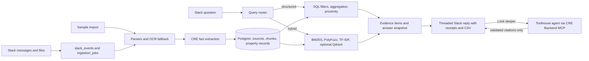

# CRE Knowledge Engine

A Slack-native evidence layer for commercial real estate (CRE) teams. Brokers already work from listing flyers, rent rolls, spreadsheets, tour notes, Slack corrections and market briefs. This project ingests that material, turns it into property facts with source receipts, and answers questions in Slack where every fact points back to the row, page, file or message it came from.

It started as a take-home assignment (a Slack AI agent for a CRE team, built on [Toolhouse](https://toolhouse.ai)). The original brief is in [problem-statement/](problem-statement/) and summarized in [docs/assignment-brief.md](docs/assignment-brief.md).

The core rule: the backend owns the facts. Toolhouse acts as a bounded second-pass reviewer over evidence the backend selected, through a narrow MCP surface. It can compare, rank and suggest, but it cannot run arbitrary SQL, invent facts, or cite evidence IDs the backend did not allow.

## Key features

- **Slack ingestion:** bounded history backfill plus live message and file events from configured channels, with per-channel policies, retry dedupe and a filter that keeps generic chatter out of the evidence store.
- **Document parsing:** CSV rows, XLSX sheets, PDF pages and text, with an optional OCR fallback (an external GLM-OCR service) for images and scanned PDFs.
- **Rich property records:** address, type and subtype, status, usage, rent, sale price, cap rate, square footage, availability, locality, coordinates, map links, loading access, parking and dock counts, plus field-level receipts (raw value, normalized value, confidence, method, source span).
- **Deterministic routing:** structured Postgres queries for filters, aggregation, proximity (PostGIS when available, Haversine fallback otherwise), exact lookups and data-quality checks.
- **Local hybrid retrieval:** BM25S, substring matching, PolyFuzz edit distance and TF-IDF character n-grams merged with Reciprocal Rank Fusion, with optional Qdrant vectors and a reranker.
- **Conflict handling:** duplicate listings are grouped and ranked by source authority and freshness, so an answer can explain why a newer correction beats an older row while still citing both.
- **Slack actions:** `Show sources`, `Look deeper`, `Follow Up with Agent` (a thread-aware modal with Instant, Auto and Agent modes) and a `/force-agent` slash command. Dense comparisons arrive as CSV files in the thread instead of cramped markdown tables.
- **Thread memory:** `ThreadSession` keeps query history, accumulated evidence IDs and cached follow-up suggestions per Slack thread.
- **Toolhouse MCP server:** 15 backend tools (schema, search, aggregation, nearby, inventory summaries, rankings, timelines, conflicts, scoped evidence expansion), mounted at `/toolhouse/mcp` with token auth, plus citation validation before anything reaches Slack.
- **Replay and verification:** every answer saves its route, filters, evidence IDs and dependency state, so it can be explained or replayed from the CLI. Golden evals, readiness checks and a secret scan are built in.

## How it works



1. Slack requests are acknowledged quickly. Slow work (parsing, indexing, answering, Toolhouse calls) runs through a Postgres-backed job queue with checkpoints and retries.
2. Sample files, history backfill and live events all go through the same importer shape, so a local test exercises the same tables and answer code as live Slack data. Imports are upserts keyed on Slack IDs, paths and content hashes.
3. The router records the route, confidence, reason codes and filters for every question. Structured questions become SQL over normalized columns; messy source-text questions go to the hybrid retriever.
4. Answers persist `queries`, `evidence_items` and `answer_snapshots`. `Show sources`, `explain-query`, `replay-query` and Toolhouse escalation all read from that trail.
5. Missing data stays missing. Renderers say "unknown SF" instead of guessing, no-result queries explain which filters applied, and a data-quality route reports gaps directly.

Exact structured answers keep working when Qdrant, the reranker or OCR are down, and degraded dependencies are recorded in health checks and answer snapshots.

## Example Slack queries

| Prompt | What it shows |
| --- | --- |
| `What properties do we have available near 123 Main Street?` | Proximity search over normalized records with sourced nearby results |
| `Show office buildings under $50/sq ft.` | Exact structured filtering on rent |
| `What is the average rent for industrial listings under $35/SF?` | Aggregation over deduped records |
| `List all properties.` | Sourced inventory overview, ready for `Look deeper` |
| `Find whse opts with trk court and trlr parking.` | Hybrid retrieval over noisy shorthand with alias expansion |
| `Which options look best for a logistics tenant under $35/SF available soon?` | Local tenant-fit scoring, then optional Toolhouse review |
| `Why did you use 62k sq ft for Harbor Rd?` | Conflict resolution: the fresher 62,000 SF correction over an older 58,000 SF row |
| `/force-agent where is this located and what is the best use case` | Direct Toolhouse path with MCP grounding |

## Tech stack

- **Backend:** Python 3.12, FastAPI, Uvicorn, Slack Bolt, SQLAlchemy (async), asyncpg, Alembic, Pydantic Settings
- **Data:** PostgreSQL 16 with PostGIS (`postgis/postgis:16-3.4-alpine`), optional Qdrant
- **Retrieval:** BM25S, PolyFuzz, scikit-learn (TF-IDF), optional embedding and rerank HTTP endpoints (configured for `qwen3-embedding-0_6b-q8_0` and `qwen3-reranker-0.6b`)
- **Parsing:** pypdf, openpyxl, optional GLM-OCR backend
- **Agent layer:** Toolhouse Workers API and the `mcp` Python SDK
- **Tooling:** uv, pytest, Docker Compose, Make

## Getting started

Prerequisites: Python 3.12, [uv](https://docs.astral.sh/uv/), Docker with Compose.

```bash
uv sync
cp .env.example .env              # then fill in values (see below)
make dev-up                       # starts the postgres and qdrant compose services
make migrate                      # alembic upgrade head
uv run cre-cli import-samples     # loads sample-data/ into Postgres
uv run cre-cli ask "Show office buildings under \$50/sq ft."
uv run cre-cli replay-query <query-id>
make run                          # FastAPI on CRE_PORT (default 8000)
```

Optional steps:

```bash
uv run cre-cli build-large-corpus --rows 2400 --seed 20260519   # regenerate the synthetic corpus shards
uv run cre-cli index-chunks --reset                             # embed chunks into Qdrant (needs an embedding endpoint)
```

Configuration lives in `.env` (template: `.env.example`). The main variables:

- App and storage: `CRE_PORT`, `CRE_DATABASE_URL`, `CRE_QDRANT_URL`, `CRE_SAMPLE_DATA_DIR`
- Slack: `CRE_SLACK_SIGNING_SECRET`, `CRE_SLACK_BOT_TOKEN`, `CRE_SLACK_APP_TOKEN`, `CRE_CONFIGURED_CHANNEL_IDS`, `CRE_SLACK_INGEST_CHANNEL_POLICIES_RAW`
- Toolhouse: `CRE_TOOLHOUSE_API_KEY`, `CRE_TOOLHOUSE_AGENT_ID`, `CRE_TOOLHOUSE_MCP_BEARER_TOKEN`
- Optional services: `CRE_VECTOR_SEARCH_ENABLED`, `CRE_EMBEDDING_URL`, `CRE_RERANK_URL`, `CRE_OCR_ENABLED`, `CRE_OCR_BACKEND_URL`, `CLOUDFLARE_PUBLIC_CALLBACK_URL`

Vector search and OCR are off by default, so the local path only needs Postgres. Slack posts to `/slack/events`, `/slack/interactivity` and `/slack/commands`; health checks are at `/health/live`, `/health/ready` and `/health/deps`.

### Tests and checks

```bash
make test                     # uv run pytest -q
uv run cre-cli eval-golden    # golden route and evidence checks
make demo-doctor              # readiness check (skips the public callback)
make secret-scan
make demo-check               # tests, golden evals, doctor, dry run, secret scan, status
```

The CLI (`cre-cli`) also includes `status`, `audit-data`, `explain-query`, `toolhouse-smoke`, Slack seeding and history sync commands, and `prune-slack-storage`.

## Gmail demo (separate prototype)

[`gmail_demo/`](gmail_demo/) is a deliberately small, standalone demo that does not need Postgres, Qdrant or Slack. Google Sheets is the demo database, Toolhouse handles the Gmail and Sheets actions, and a local MCP backend (port 8030) exposes nine tools for seeding 30 synthetic Austin properties, validating events, BM25 search, requirement matching and composing a grounded reply. A sender script delivers ten `[CRE-DEMO]` emails and triggers a Toolhouse run after each one.

```bash
cp .env.gmail-demo.example .env.gmail-demo
uv run --env-file .env.gmail-demo gmail-demo-check
uv run --env-file .env.gmail-demo python -m gmail_demo
uv run --env-file .env.gmail-demo python -m gmail_demo.seed --dry-run
```

See the [Gmail demo runbook](docs/gmail-demo-runbook.md), the [Toolhouse prompt](docs/toolhouse-gmail-demo-agent-prompt.md) and the [post-demo roadmap](docs/gmail-rag-pivot-roadmap.md).

## Project structure

```
app/              FastAPI app, Slack handlers, ingestion, extraction, routing,
                  retrieval, answering, Toolhouse client and MCP server, CLI
alembic/          database migrations
gmail_demo/       standalone Gmail + Sheets demo backend
gmail-demo-data/  synthetic properties and email templates for that demo
sample-data/      hand-authored fixtures plus a generated 2,400-record corpus
docs/             design notes, runbooks, retrieval spec, Toolhouse agent files
tests/            pytest suite (golden answers, Slack loop, parsers, MCP tools)
scripts/          recover-demo-stack.sh for restarting the local demo stack
```

## Further reading

- [Retrieval and routing spec](docs/retrieval-routing-spec.md)
- [Production practices and trade-offs](docs/production-practices.md)
- [Sample data and evaluation](docs/sample-data-and-evaluation.md)
- [Slack demo runbook](docs/slack-demo-runbook.md) and [video script](docs/slack-demo-video-script.md)
- [Toolhouse integration](docs/slack-toolhouse-integration.md)

## Limitations and next steps

This is a prototype run against a single Slack workspace. The sample corpus is synthetic: the generated shards are tagged as demo data, not scraped listings. Field extraction is heuristic. Natural next steps are OAuth and multi-workspace permissions, admin review for low-confidence extraction, object storage for files, telemetry, external geocoding and drive-time search, retrieval benchmarks, and retention and deletion workflows for Slack data.
